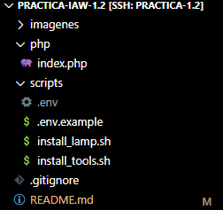
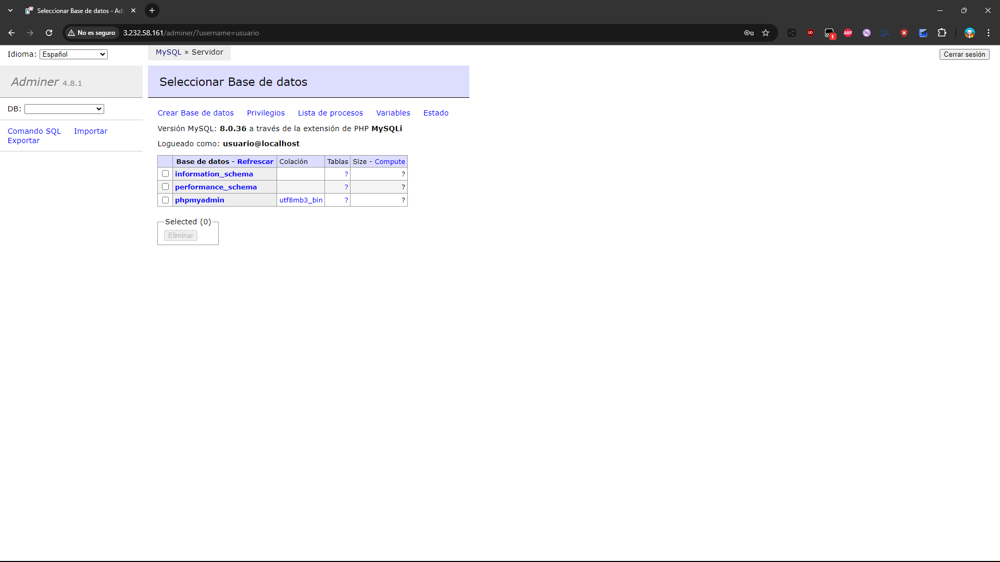

# Practica-IAW-1.2- Instalación de LAMP Stack en RHEL

## Pasos previos a la instalación

**para la instalación vamos a tener que crear la siguiente estructura de directorios y archivos:**



**Una vez creados los archivos y directorios, procedemos a la instalación de las herramientas.**

## Instalación de LAMP Stack en RHEL

## 1. Creación del archivo `install_lamp.sh` para la automatización del proceso de instalación

### Actualizamos los paquetes del sistema y mostramos los comandos que se van ejecutando. 

```
dnf update -y
```

> [!NOTE]  
> En Red Hat, par la instalación de paquetes y actualizaciones, se utiliza la herramienta `dnf`

```
set -ex
```

## 1.1 Instalación del Servidor web Apache

### Paso 1: Instalamos el servidor web Apache

```
dnf install httpd -y
```

### Paso 2: Iniciamos el servicio de Apache

```
systemctl start httpd
```

### Paso 3: Habilitamos el servicio para que se inicie automaticamente despues de cada reinicio

```
systemctl enable httpd
```

## 1.2 Instalación de MySQL Server

### Paso 1: Instalamos MYSQL server

```
dnf install mysql-server -y
```

### Paso 2: Iniciamos el servicio de Mysql

```
systemctl start mysqld
```

### Paso 3: Habilitamos el servicio para que se inicie automaticamente despues de cada reinicio 

```
systemctl enable mysqld
```

## 1.3 Instalación de el interprete de PHP

### Paso 1: Instalamos el interprete de PHP

```
dnf install php -y
```

### Paso 2: Instalamos la extensión para que PHP pueda conectar con MySQL

```
dnf install php-mysqlnd -y
```

### Paso 3: Reinciamos el servicio de Apache

```
systemctl restart httpd
```

### Paso 4: Copiamos el index.php de prueba en /var/www/html

```
cp ../php/index.php /var/www/html
```

---
## 2. Creación del archivo `install_tools.sh` para la automatización del proceso de instalación

### Importamos el archivo de variables

```
source .env
```

> [!NOTE]  
> Este archivo de configuración se hace para que lo que vamos a hacer mas adelante reconozca las variables configuradas en ese archivo. Todas las variables que aparezcan en este documento, están dentro del archivo `.env`

> [!WARNING]  
> Otra cosa a tener en cuenta es que este archivo es publico en el repositorio y pues toda la gente que vea el repositorio puede ver las contraseñas y usuarios que tiene el archivo, asi que para evitar eso, hacemos un archivo `.gitignore` y dentro de él ponemos `.env` para que ignore ese archivo para que a la hora de subirlo esté oculto al público. Lo que podemos hacer para que la gente sepa que variables se configuran podemos hacer un `.env.example` y dentro poner las variables vacías para que sepan que se tienen que configurar con un .env.

### Actualizamos los paquetes del sistema y mostramos los comandos que se van ejecutando 

```
dnf update -y
```

```
set -ex
```

## 2.1 Instalamos las dependencias necesarias para phpmyadmin

```
dnf install php-mbstring php-zip php-json php-gd php-fpm php-xml -y
``` 

**Después de este comando, reiniciamos el servicio de apache con el comando:**

**`systemctl restart httpd`**

## 2.2 Instalacion de wget

### Paso 1: Instalamos la utilidad wget

```
dnf install wget -y
```

> [!NOTE]  
> Esta utilidad nos la descargamos ya que nos hace falta para poder descargar el código fuente de `phpmyadmin`.

### Paso 2: Descargamos el código fuente de phpmyadmin en /var/www/html

```
wget https://www.phpmyadmin.net/downloads/phpMyAdmin-latest-all-languages.tar.gz -P /var/www/html
```

> [!TIP]  
> Con el parámetro `-P` podemos indicar la ruta donde queremos guardar el archivo que nos descarguemos con la utilidad `wget`, en mi caso, lo he guardado en la ruta `/var/www/html`.

### Paso 3: Descomprimimos el archivo anterior

```
tar xvf /var/www/html/phpMyAdmin-latest-all-languages.tar.gz -C /var/www/html
```

### Paso 4: Eliminamos el archivo tar.gz

```
rm /var/www/html/phpMyAdmin-latest-all-languages.tar.gz
```

### Paso 4: Eliminamos instalaciones previas de phpmyadmin

```
rm -rf /var/www/html/phpmyadmin
```

> [!IMPORTANT]  
> Esto lo hacemos para que a la hora de ejecutar el archivo para que haga todo automáticamente no haya conflictos con los archivos y se pueda alojar en la ruta sin problemas de duplicidad.

### Paso 5: Renombramos el nombre del directorio de phpmyadmin

```
mv /var/www/html/phpMyAdmin-5.2.1-all-languages/ /var/www/html/phpmyadmin
```

> [!TIP]  
> Es recomandable renombrar el directorio ya que el nombre original es muy largo y a veces eso puede provocar problemas, asi que para evitar sustos, le cambiamos el nombre a `phpmyadmin`.

### Paso 6: Modificamos el propietario y el grupo del directorio

```
chown -R apache:apache /var/www/html/phpmyadmin
```


## 2.3 Instalacion de Adminer

### Paso 1: Creamos un directorio para adminer

```
mkdir -p /var/www/html/adminer
```

### Paso 2: Instalamos Adminer

```
wget https://github.com/vrana/adminer/releases/download/v4.8.1/adminer-4.8.1-mysql.php -P /var/www/html/adminer
```

**Con el comando `wget` nos descargamos el archivo de adminer y con el parámetro `-p` le indicamos la ruta donde lo queremos guardar.**

### Paso 3: Renombramos el nombre del script de Adminer

```
mv /var/www/html/adminer/adminer-4.8.1-mysql.php /var/www/html/adminer/index.php
```

> [!TIP]  
> Renombramos el directorio ya que el nombre que tiene es muy largo y lo cambiamos a uno mas común con el archivo del `index.php` para que el servidor apache lo pueda reconocer más fácil.

### Paso 4. Modificamos el propietario y el grupo del archivo

```
chown -R www-data:www-data /var/www/html/adminer
```

**Una vez más tenemos que darle permisos al grupo y usuario de apache para que pueda leer el archivo.**

### Paso 5: comprobación de que la página `adminer` funciona


